# ⛪ church-template

**교회 홈페이지를 위한 풀스택 템플릿 — 한 번 만들고, 교회마다 복사해서 연다**

템플릿 레포 하나(`client/` + `server/` 모노레포)를 **Use this template**으로 복사하고, 
교회 정보·사진·`.env`만 채우면 새 교회 사이트가 됩니다.

**운영 중인 첫 사이트 → [www.eunsaem.com](https://www.eunsaem.com)** (기독교 한국침례회 은샘교회)

  
  

## 📦 저장소

| 저장소 | 설명 |
|---|---|
| [**church-template**](https://github.com/church-template/church-template) | **템플릿** — Next.js 프론트(`client/`) + Spring Boot API(`server/`) 모노레포. 새 교회는 여기서 시작 |
| [**eunsaem-frontend**](https://github.com/church-template/eunsaem-frontend) | 은샘교회 웹사이트 (운영) |
| [**eunsaem-backend**](https://github.com/church-template/eunsaem-backend) | 은샘교회 API 서버 (운영) |

새 교회 레포는 템플릿에서 만들어 `<교회>-church`로 이름 붙입니다.

## 🧱 새 교회 사이트 만들기

<picture>
  <source media="(prefers-color-scheme: dark)" srcset="images/new-church-dark.svg">
  -church 레포를 만들고, 교회 정보 상수와 사진·색을 채우고, server .env를 준비한 뒤, Secrets를 등록하고 develop에서 main으로 첫 릴리스를 하면 사이트가 열린다." src="images/new-church-light.svg">
</picture>

자세한 순서와 바꿀 파일 목록은 [템플릿 README](https://github.com/church-template/church-template#새-교회-만들기)에 있습니다.

## 🗺️ 한 교회 사이트의 구조

<picture>
  <source media="(prefers-color-scheme: dark)" srcset="images/runtime-dark.svg">
  
</picture>

릴리스는 `develop` → `main` PR 하나로 끝납니다 — 버전·릴리스 노트는 [projectops](https://github.com/Cassiiopeia/projectops)가 만들고, `client/`는 Vercel로, `server/`는 GHCR 이미지 + SSH로 배포됩니다. → [Git Flow](https://github.com/church-template/church-template#git-flow)

## 🧭 설계 원칙

- **멀티테넌시 대신 교회마다 별도 인스턴스** — 데이터 격리를 인프라에 맡기고 코드는 한 교회 기준으로 단순하게
- **교회별 값은 설정으로** — 프론트는 상수 파일, 백엔드는 `.env`. 본문 이미지도 URL 대신 `media:{id}`로 저장해 도메인이 바뀌어도 그대로 동작
- **직분과 권한을 분리한 RBAC** — 권한 단위로 인가하고, 자기보다 낮은 역할만 부여 가능
- **고령 사용자를 고려한 단순함** — 큰 글자, 이메일 인증·복잡한 비밀번호 정책 대신 관리자가 교인 확인

## 👤 만든 사람

[홍의민 (EM-H20)](https://github.com/EM-H20) — 프론트엔드·백엔드·배포까지 1인 개발
